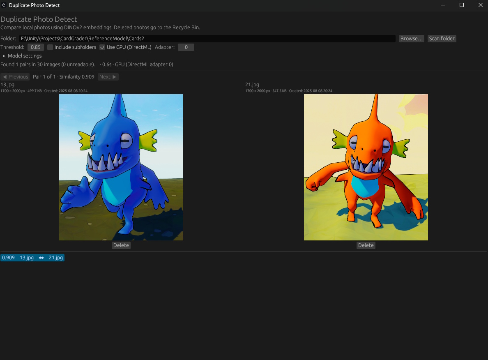

# Duplicate Photo Detect

Native Windows desktop application built with egui/eframe and the `ort` ONNX Runtime binding. 



## Build and run

Requires Windows x64, stable Rust with the MSVC toolchain, and the Visual Studio C++ build tools / Windows SDK. 

```powershell
cargo run --locked
```

This repository includes everything specific to the app:

- `Model/model_fp16.onnx`: the DINOv2 small fp16 model.
- `Model/preprocessor_config.json`: the reference preprocessing configuration.
- `Runtime/win-x64/`: ONNX Runtime 1.24.4 DirectML and DirectML 1.15.4 native libraries.
- `Runtime/licenses/`: bundled dependency licenses and notices.

Cargo's build script copies the three native DLLs beside the development or release executable. The app locates the model relative to its executable or working directory and their parents; it can also be selected in Model settings. Keep the `ort` binding and bundled runtime versions compatible when upgrading.

Rust dependencies are pinned in `Cargo.lock` and downloaded by Cargo on the first build. Windows may also require the Microsoft Visual C++ 2015–2022 x64 Redistributable.

## Package a release

```powershell
./package.ps1
```

The script builds an optimized executable and creates `dist/DuplicatePhotoDetect-win-x64.zip`, including the model, runtime DLLs, and license files. Extract the complete ZIP and launch `duplicate-photo-detect.exe`. No browser or local web server is used.

Optional arguments: `-OutputDirectory`, `-ModelPath`, and `-RuntimeDirectory`. Defaults use only files inside this repository. The `dist/` and `target/` directories are build output and excluded from Git; the model and runtime source assets are included.

## Features

- Folder picker, adjustable threshold, optional subfolder scanning (off by default, matching the current Blazor app).
- DirectML GPU adapter selection with CPU fallback.
- Batch inference (32 images), parallel image preprocessing, in-memory embeddings cached by path, size, and modification date.
- Side-by-side thumbnails with dimensions, size, and filesystem creation date.
- Previous/next pair navigation and virtualized pair list.
- Confirmed Recycle Bin deletion, no success notification or full-size preview.
- Background scanning, progress, elapsed time, and cooperative cancellation between batches and comparison rows. An inference already in progress finishes before cancellation takes effect.

The same DINOv2 preprocessing and normalized CLS similarity are used: resize shortest edge to 256, center crop 224×224, ImageNet RGB normalization, and cosine similarity. Image decoders and resampling differ from SkiaSharp, so scores can vary slightly; thresholds should be checked against representative photos.

## Verification

`cargo test --locked` checks preprocessing. After packaging, run:

```powershell
./dist/DuplicatePhotoDetect/duplicate-photo-detect.exe --smoke-test
```

This processes a generated image through the real model on CPU and requested DirectML adapter 0 (with fallback), checks normalized 384-dimensional embeddings and identical-image similarity, and prints the actual selected device. It does not delete photos.
