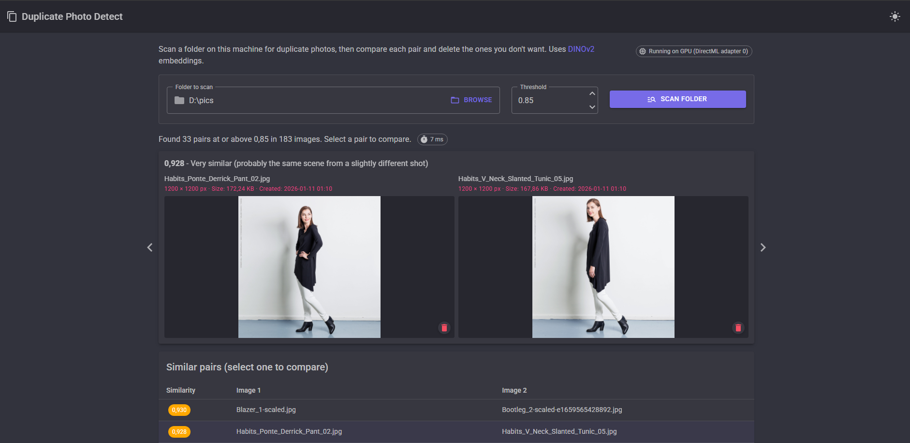

# Duplicate Photo Detect

A standalone Blazor (MudBlazor) web app that scans a folder for duplicate photos, so you can compare each pair and delete the ones you don't want.
Each photo is turned into a [DINOv2](https://huggingface.co/facebook/dinov2-small) embedding and photos are compared with cosine similarity,
which catches the same photo even after it has been resized, cropped, recompressed or brightened.

- The selected pair stays at the top of the window while you scroll through the list of pairs (the most similar pair is selected after a scan).
- Each photo has a delete button, in the list and above the selected pair. After you confirm, the photo is moved to the Windows Recycle Bin
  (so it can be restored), and every pair it was in is removed from the list.

It doesn't depend on anything else in this repository, so the folder can be copied out on its own.

## Running it

Run `dotnet run --project DuplicatePhotoDetect` (or open `DuplicatePhotoDetect.sln`), then open http://localhost:5180.

Requires the .NET 8 SDK and Windows (the model runs on the GPU with DirectML).

## Settings

In the `DuplicatePhotoDetect` section of `appsettings.json`:

| Setting | Default | |
|---|---|---|
| `ModelPath` | empty | The DINOv2 model file. Empty looks for `Model\model_fp16.onnx` in the working directory, the app's folder and their parents |
| `UseGpu` | `true` | Run the model on the GPU with DirectML. Falls back to the CPU if the GPU can't be used |
| `GpuDeviceId` | `0` | The DirectML adapter: 0 is usually the integrated GPU and 1 the dedicated one. The page shows which device the model is running on |
| `DefaultFolder` | empty | The folder the scan box starts with. Empty uses `Sample Images\Listing` if it can be found |

## Similarity scores

Rough guide (based on testing with listing photos, calibrate on your own data):

| Similarity | Meaning |
|---|---|
| 0.95 and above | Duplicate (same photo, possibly resized, cropped or edited) |
| 0.85 - 0.95 | Very similar (probably the same scene from a slightly different shot) |
| 0.6 - 0.85 | Similar (same kind of room or view) |
| below 0.6 | Different |

Folder scans run 32 photos through the model at a time, which is much faster on the GPU than one at a time.
Embeddings are cached while the app runs, so scanning the same folder again (e.g. with a different threshold) is quick.
